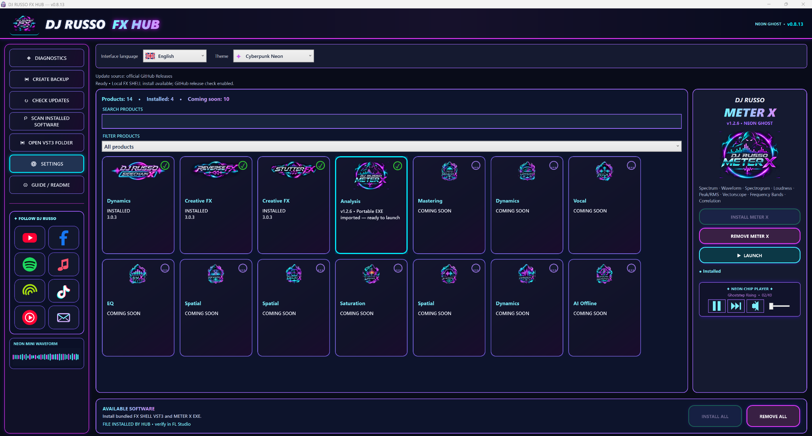

# DJ RUSSO FX HUB
### NEON GHOST · Audio Tools Manager for Windows

**Manage DJ RUSSO audio tools in one place.**

[**Download latest public version**](https://github.com/djrusso1994/DJ-RUSSO-FX-HUB/releases) · [**Windows builds**](https://github.com/djrusso1994/DJ-RUSSO-FX-HUB/actions) · [**Report an issue**](https://github.com/djrusso1994/DJ-RUSSO-FX-HUB/issues)

  

---

## Interface gallery

Explore the real **DJ RUSSO FX HUB** interface. Click any screenshot to view it at full resolution.

| **Main Dashboard** | **Installed Plugins** |
|:---:|:---:|
|  |  |

| **METER X Monitoring** | **Dark Professional Theme** |
|:---:|:---:|
|  |  |

## Included tools

- **DJ RUSSO METER X** — Windows audio monitoring application.
- **DJ RUSSO FX SHELL** — a single VST3 module providing **Sidechain X**, **Reverse FX**, and **Stutter FX**.
- **More audio tools** — shown as *Coming Soon*; not yet available for installation.

The FX HUB itself is a Windows application, **not a VST3 plugin**.

## Features

- Install and remove supported DJ RUSSO tools.
- View installation status and launch supported applications.
- Search and filter the audio-tool catalog.
- Choose interface language and visual theme.
- Check GitHub Releases for newer versions, including preview releases.
- Open diagnostics, backup tools and the VST3 directory.
- Neon Ghost visual design and mini chip player.

## Download and install

1. Open [GitHub Releases](https://github.com/djrusso1994/DJ-RUSSO-FX-HUB/releases).
2. Download the Windows x64 **Setup .exe** from the latest published release.
3. Run the installer and launch **DJ RUSSO FX HUB**.
4. Close your DAW before installing or removing VST3 effects.
5. Open FL Studio's Plugin Manager and rescan plugins after installation.

**Latest published build:** see [GitHub Releases](https://github.com/djrusso1994/DJ-RUSSO-FX-HUB/releases). The version badge above updates automatically when a new release is published, including prereleases.

## Compatibility and important notes

- Windows x64; developed with WPF and .NET 8.
- FL Studio is the primary testing DAW; other VST3 hosts are not yet fully validated.
- FX SHELL contains three effects in **one shared VST3 file**. Do not manually split or duplicate it.
- Installation may require Windows administrator permission.
- Always back up important projects and plugins before testing.
- The update checker **notifies and opens GitHub Releases**; it does not silently download or install software.
- The source project builds the HUB and bundles precompiled payloads. It does **not** build the JUCE audio DSP.

## Development and release process

Changes to the `main` branch trigger a Windows test build through GitHub Actions. **Public stable releases require approval after testing.** Build artifacts and public Releases are separate download channels.

### Current changes under test (v0.8.15)

- Correct GitHub update checking when only pre-releases exist (fixes the 404 response).
- Fit long product titles inside the right-side details panel, including Vocal Remover X.
- Refresh documentation and prepare the visual gallery.

These changes have been committed to source; successful compilation and Windows behavior must still be verified.

## Build from source

Open `DJRussoFXHub.slnx` with Visual Studio 2022 or later and the **.NET desktop development** workload, then build for Windows x64. Keep the bundled `Payload` files alongside the published application.

---

**Created by DJ RUSSO** · [Official downloads](https://github.com/djrusso1994/DJ-RUSSO-FX-HUB/releases)

### Guided HUB updates (v0.8.15 test build)

When a newer official GitHub Release includes an installer with a published SHA-256 digest, the HUB can offer to download, verify and launch the installer. Installation requires user confirmation and may request Windows administrator permission. Older releases without a digest open in the browser instead. Plugin auto-updates are **not** yet implemented. Test on Windows before publishing as stable.
