

# DJ RUSSO FX HUB
### NEON GHOST

**Manage DJ RUSSO audio tools in one place.**

[**Download latest stable version**](https://github.com/djrusso1994/DJ-RUSSO-FX-HUB/releases/latest) · [**Release notes**](https://github.com/djrusso1994/DJ-RUSSO-FX-HUB/releases/tag/v0.8.45) · [**Report an issue**](https://github.com/djrusso1994/DJ-RUSSO-FX-HUB/issues)

  

**Latest stable release: v0.8.45 · 10/14 audio tools available (71.4%)**

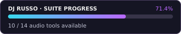

**9 VST effects + 1 standalone application · 4 tools remaining**

  

<em>FX HUB showcase · Nine real interface slides · Neon Ghost · HUB v0.8.43 and plugin captures including STEREO X v1.2.0</em>

---

## Overview

DJ RUSSO FX HUB is a Windows x64 application for installing, managing and updating DJ RUSSO audio tools from a single interface. It brings nine VST effects and the standalone METER X audio analyzer together in the Neon Ghost environment.

## Download and install

[**Download FX HUB v0.8.45 — Windows x64 installer**](https://github.com/djrusso1994/DJ-RUSSO-FX-HUB/releases/download/v0.8.45/DJ_RUSSO_FX_HUB_Setup_v0.8.45.exe) · [Latest stable release](https://github.com/djrusso1994/DJ-RUSSO-FX-HUB/releases/latest)

1. Download and run the official Setup EXE. Choose English, Italian, Spanish, French or German.
2. Launch FX HUB. Close your DAW before installing or removing VST effects.
3. Select a tool or use **Install all**. Approve administrator access when requested.
4. Rescan your VST3 plugins in your DAW. Launch METER X directly from the HUB.

## What's new in v0.8.45 — current stable release

- **STEREO X v1.2.0 Professional Edition:** stereo imaging, width and balance, phase analysis, presets and FL Studio automation. Owner tested project recall and automation.
- **Ten of fourteen tools:** individual verified download, installation/removal, bulk operations and diagnostics for STEREO X.
- **Interactive guide:** floating return-to-contents chevron, smooth scrolling, theme-aware glow and localized tooltip.
- Existing audio binaries and plugin identities are preserved. Windows build passed and the developer confirmed the HUB test version works.

## Individual downloads — no FX HUB required

Prefer to download just one tool? These official Windows x64 binaries are the same payloads included in FX HUB v0.8.45.

| Tool | Version | Format | Download |
|---|---|---|---|
| **FX SHELL** — Sidechain X, Reverse FX, Stutter FX | 3.0.3 | VST3 | [Download VST3](https://raw.githubusercontent.com/djrusso1994/DJ-RUSSO-FX-HUB/2c6dcfef8ebd5da832bb40d1bb2bfb782e4b8d1a/Payload/DJ%20RUSSO%20FX%20SHELL.vst3) |
| **REVERB X** | 1.3 | VST3 | [Download VST3](https://raw.githubusercontent.com/djrusso1994/DJ-RUSSO-FX-HUB/2c6dcfef8ebd5da832bb40d1bb2bfb782e4b8d1a/Payload/DJ%20RUSSO%20REVERB%20X.vst3) |
| **DELAY X** | 1.3 | VST3 | [Download VST3](https://raw.githubusercontent.com/djrusso1994/DJ-RUSSO-FX-HUB/2c6dcfef8ebd5da832bb40d1bb2bfb782e4b8d1a/Payload/DJ%20RUSSO%20DELAY%20X.vst3) |
| **COMPRESSOR X** | 2.2 | VST3 | [Download VST3](https://raw.githubusercontent.com/djrusso1994/DJ-RUSSO-FX-HUB/7c15ea42c603ac397ac5e39bf8fd5a8144e0e2d8/Payload/DJ%20RUSSO%20COMPRESSOR%20X.vst3) |
| **EQ X** | 1.1.1 | VST3 | [Download VST3](https://raw.githubusercontent.com/djrusso1994/DJ-RUSSO-FX-HUB/89aecc51051d3cc9c1005e62f1fa8c34278c12da/Payload/DJ%20RUSSO%20EQ%20X.vst3) |
| **DRIVE X** | 1.3.3 | VST3 | [Download VST3](https://raw.githubusercontent.com/djrusso1994/DJ-RUSSO-FX-HUB/f2c72c828c339c3ab81aa54f7843523c00a8c216/Payload/DJ%20RUSSO%20DRIVE%20X.vst3) |
| **STEREO X** | 1.2.0 | VST3 | [Download VST3](https://raw.githubusercontent.com/djrusso1994/DJ-RUSSO-FX-HUB/f99f2130c7893b2e391b6b870d57d2060203692a/Payload/DJ%20RUSSO%20STEREO%20X.vst3) |
| **METER X** | 1.2.6 | Portable EXE | [Download EXE](https://raw.githubusercontent.com/djrusso1994/DJ-RUSSO-FX-HUB/2c6dcfef8ebd5da832bb40d1bb2bfb782e4b8d1a/Payload/DJ%20RUSSO%20METER%20X.exe) |

**Manual installation:** close your DAW, back up any existing plugin, then copy the downloaded `.vst3` file to `C:\Program Files\Common Files\VST3` (administrator permission may be required). Rescan your plugins in your DAW. METER X is a standalone Windows executable and does not belong in the VST3 folder.

FX SHELL is a single shared VST3 module containing three effects; do not split or duplicate it. These direct links are pinned to the verified release-source commits, not the development branch. They are raw binaries, not separate setup installers. For guided installation, conflict checks and HUB updates, use the [FX HUB installer](https://github.com/djrusso1994/DJ-RUSSO-FX-HUB/releases/latest).

---

## FX HUB interface

[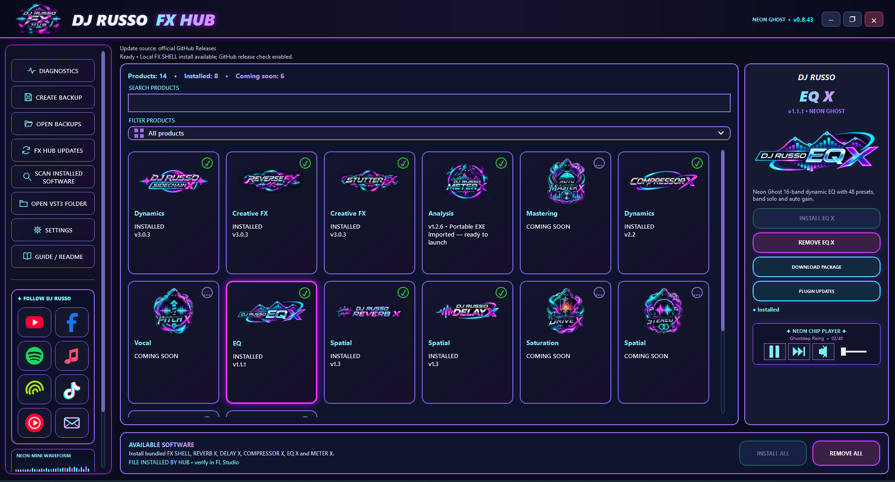](screenshots/hub-dashboard.png)

These real interface captures depict HUB v0.8.43.

| Bulk installation | Settings and security |
|:---:|:---:|
| [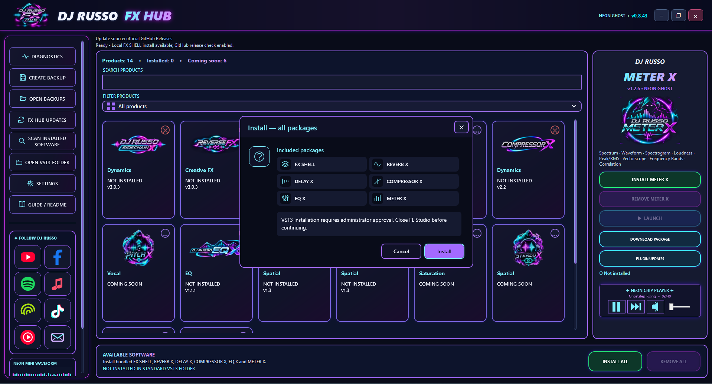](screenshots/hub-install.png) | [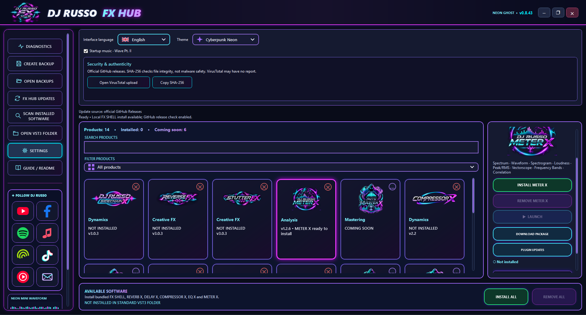](screenshots/hub-settings.png) |
| **Diagnostics** | **Interactive guide** |
|  |  |

## FX HUB plugin gallery

| SIDECHAIN X · FX SHELL v3.0.3 | REVERSE FX · FX SHELL v3.0.3 |
|:---:|:---:|
| [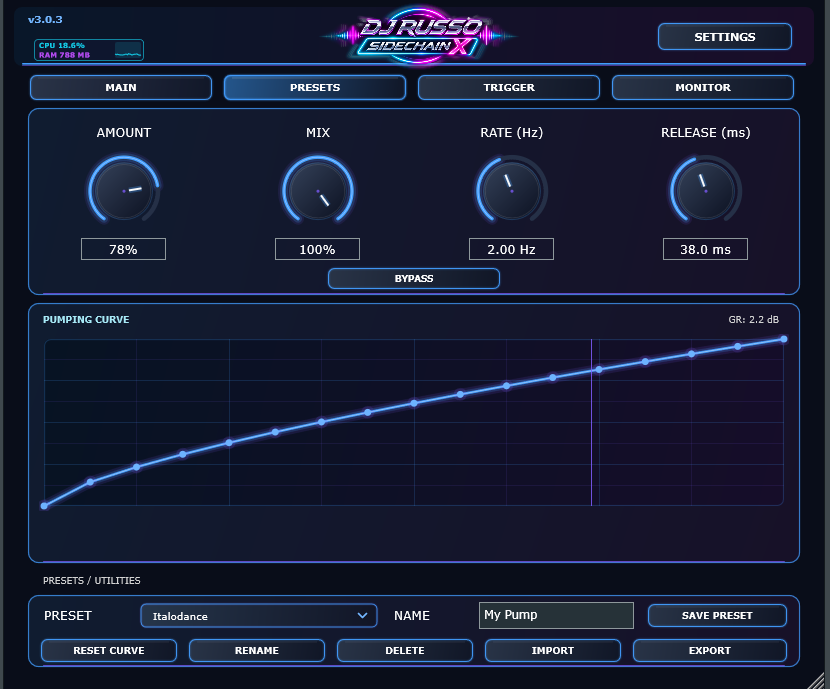](screenshots/sidechain-x.png) |  |
| **STUTTER FX · FX SHELL v3.0.3** | **REVERB X v1.3** |
| [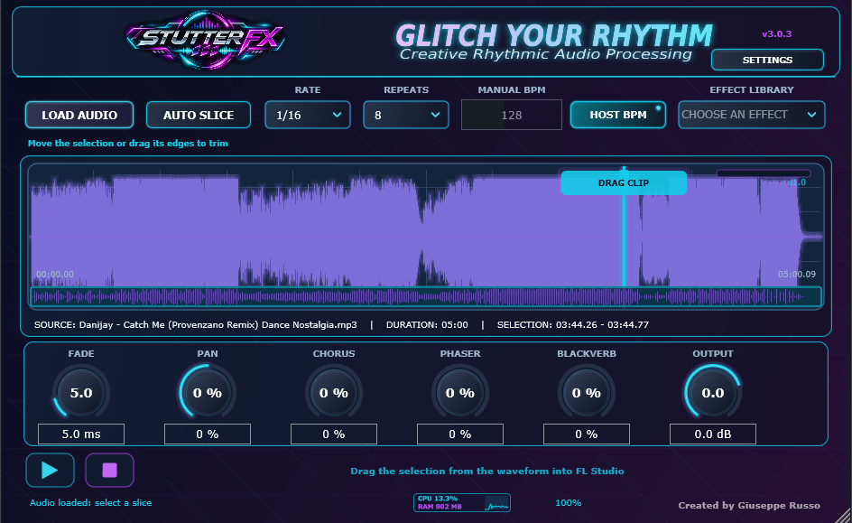](screenshots/stutter-fx.png) |  |
| **DELAY X v1.3** | **COMPRESSOR X v2.2** |
| [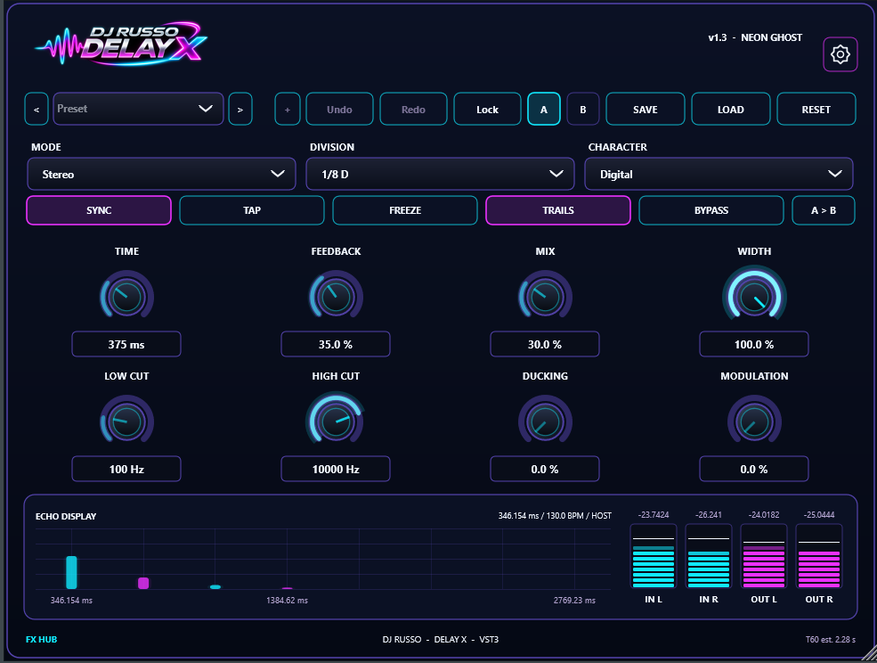](screenshots/delay-x.png) | [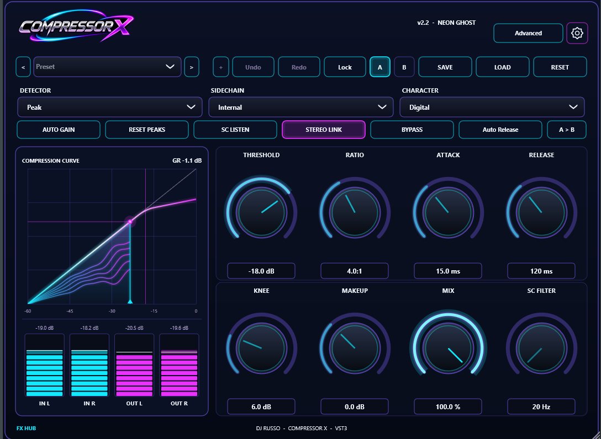](screenshots/compressor-x.png) |
| **EQ X v1.1.1** | **METER X · standalone** |
| [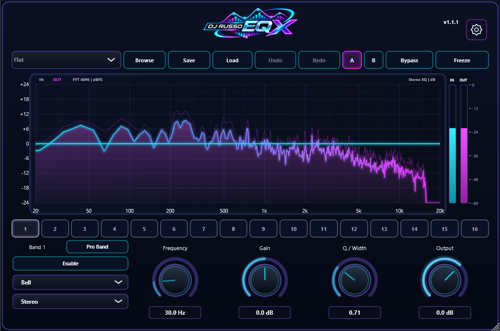](screenshots/eq-x.png) |  |

METER X is a portable standalone application; Sidechain X, Reverse FX and Stutter FX share one FX SHELL VST3 module.

### STEREO X v1.2.0 — Professional Edition

| Phase monitor and live spectrum | Vectorscope and stereo analysis |
|:---:|:---:|
| [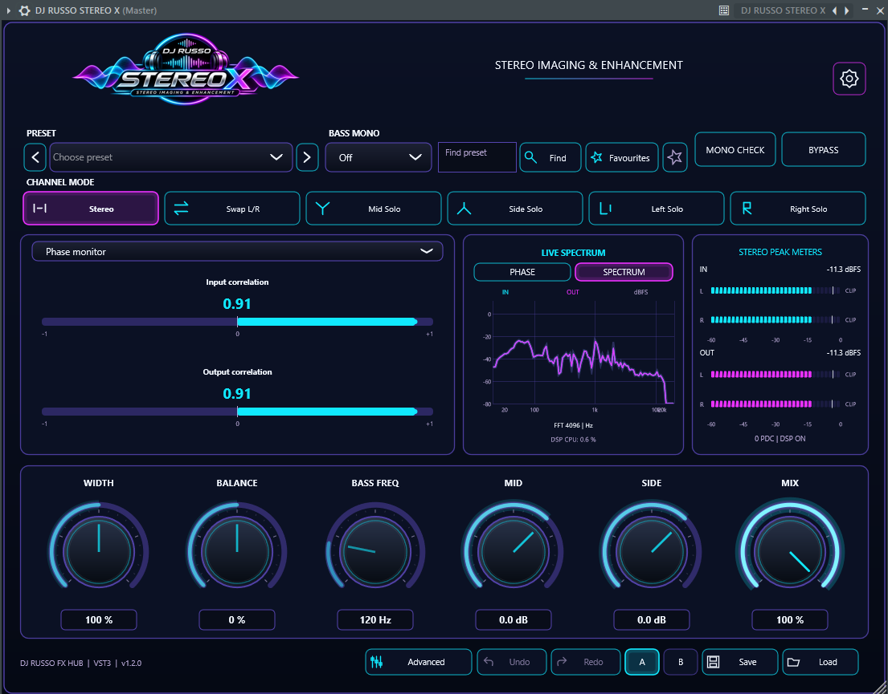](screenshots/stereo-x-phase-monitor.png) | [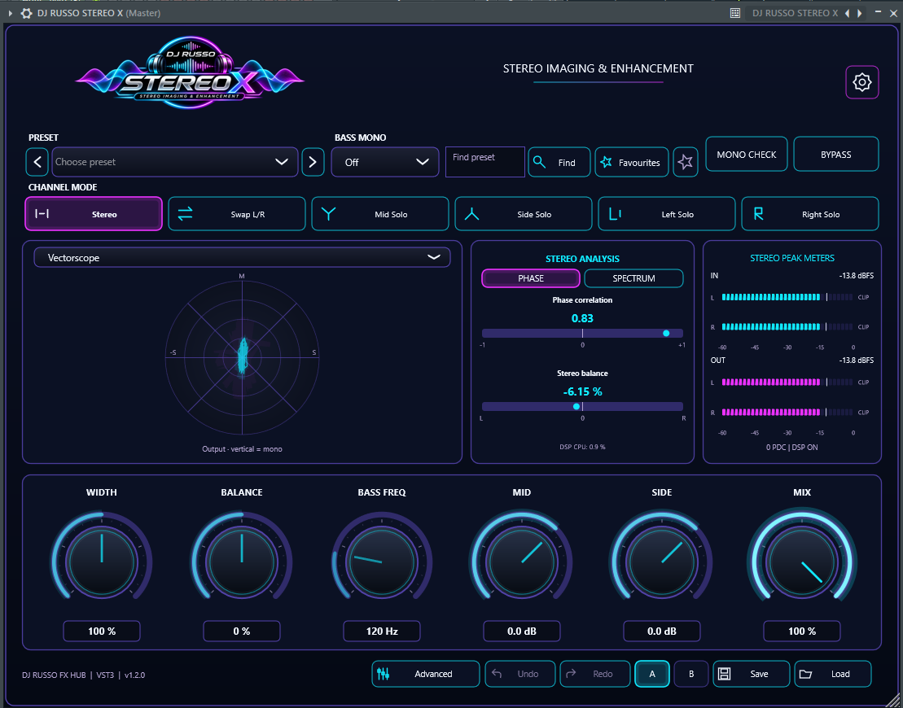](screenshots/stereo-x-vectorscope.png) |

Real FL Studio interface captures supplied by the developer. Click either screenshot to enlarge.

## Included tools

**Ten available audio tools** are managed through one Windows application:

- **DJ RUSSO METER X v1.2.6** — Windows audio monitoring application.
- **DJ RUSSO FX SHELL v3.0.3** — one shared VST3 module containing **Sidechain X**, **Reverse FX**, and **Stutter FX**.
- **DJ RUSSO REVERB X v1.3** — independent Neon Ghost VST3 effect with adjustable reverb controls, stereo IN/OUT meters, presets, and FL Studio automation support.
- **DJ RUSSO DELAY X v1.3** — independent Neon Ghost VST3 delay effect with stereo delay controls, presets, and FL Studio automation support.
- **DJ RUSSO COMPRESSOR X v2.2** — independent VST3 dynamics effect.
- **DJ RUSSO EQ X v1.1.1** — independent dynamic EQ VST3.
- **DJ RUSSO DRIVE X v1.3.3** — independent saturation VST3 with six algorithms and live spectrum.
- **DJ RUSSO STEREO X v1.2.0** — independent stereo imaging VST3 with width, balance and phase monitoring.
- **Coming soon:** AUTO MASTER X, PITCH X, TRANSIENT X and VOCAL REMOVER X.

The FX HUB itself is a **Windows application, not a VST3 plugin**. FX SHELL, REVERB X, DELAY X, COMPRESSOR X, EQ X, DRIVE X, STEREO X and METER X can be installed or removed individually, or managed together with the supported bulk actions.

## Main features

- Individual and bulk installation/removal, with protection for external or modified VST3 files.
- Verified VST detection, separate METER X status, search and catalog filters.
- Guided HUB updates from official GitHub releases and verified individual plugin downloads.
- Local diagnostics, backups, VST3 folder access and an interactive user guide.
- Five interface languages and three visual themes: Neon Ghost, Dark Professional and Light Modern.
- Original startup music (Wave Pt. II), optional playback and mini chip player.

## Compatibility and security

- Windows x64; FL Studio is the primary tested host. Other VST3 hosts are not yet fully validated.
- FX SHELL contains three effects in one VST3 module. Do not split or duplicate it. METER X is a standalone EXE.
- VST3 files are installed in `C:\Program Files\Common Files\VST3`. Back up your projects and existing plugins before making changes.
- The HUB checks official releases and can offer a user-confirmed installer download with SHA-256 integrity verification. If verification metadata is unavailable, it opens the official release in your browser. Updates are never installed silently.
- Automatic VST3 updates are not yet enabled; use the verified individual downloads when needed.
- SHA-256 verifies integrity, not malware safety. In Settings, the VirusTotal option lets you manually upload the official installer for analysis. Uploading shares the file with VirusTotal; review its privacy terms first. A missing report does not prove a file safe or unsafe.

## Release history and support

[**Latest release**](https://github.com/djrusso1994/DJ-RUSSO-FX-HUB/releases/latest) · [Full changelog](CHANGELOG.txt) · [All releases](https://github.com/djrusso1994/DJ-RUSSO-FX-HUB/releases) · [Report an issue](https://github.com/djrusso1994/DJ-RUSSO-FX-HUB/issues)

---

**Created by DJ RUSSO** · [Official downloads](https://github.com/djrusso1994/DJ-RUSSO-FX-HUB/releases)

