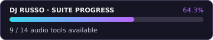
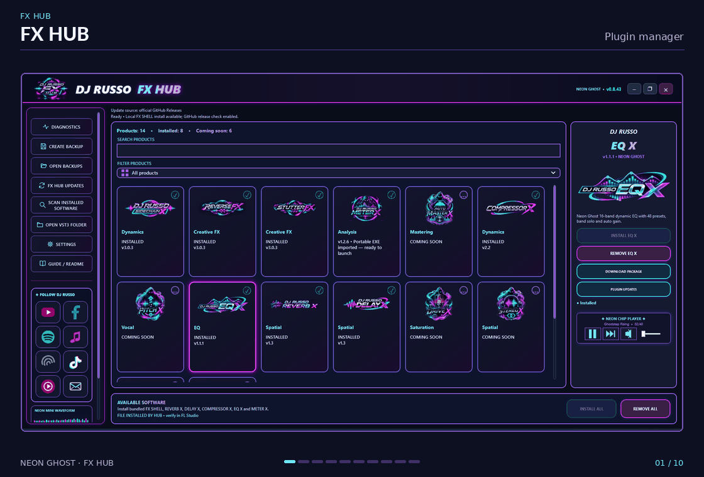
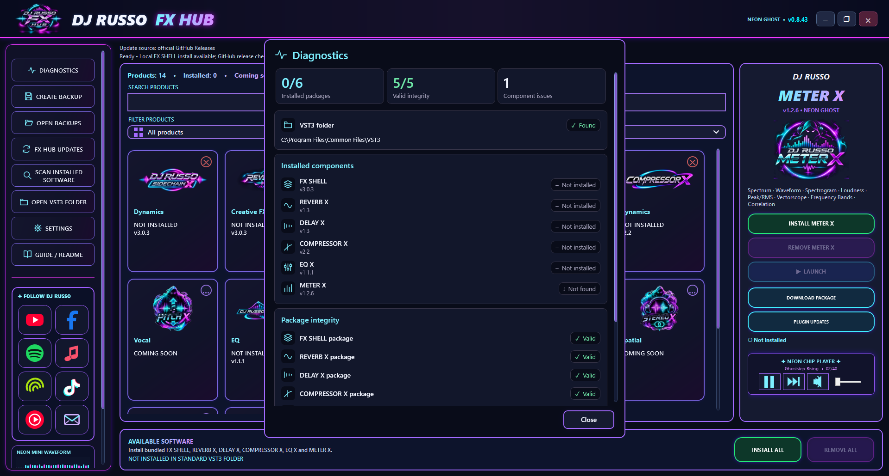
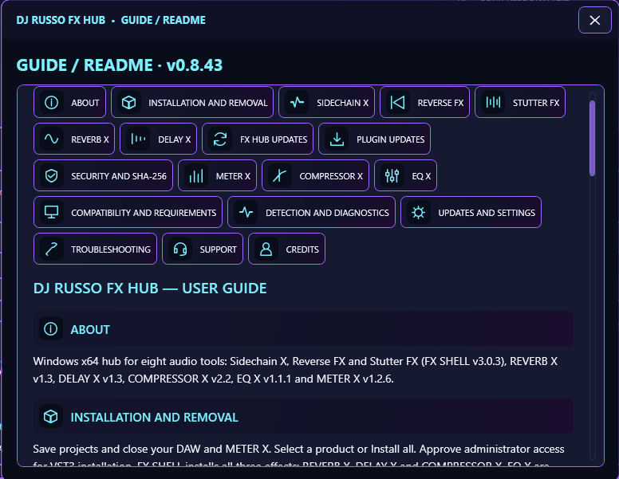
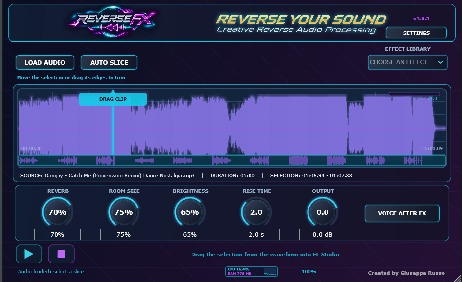
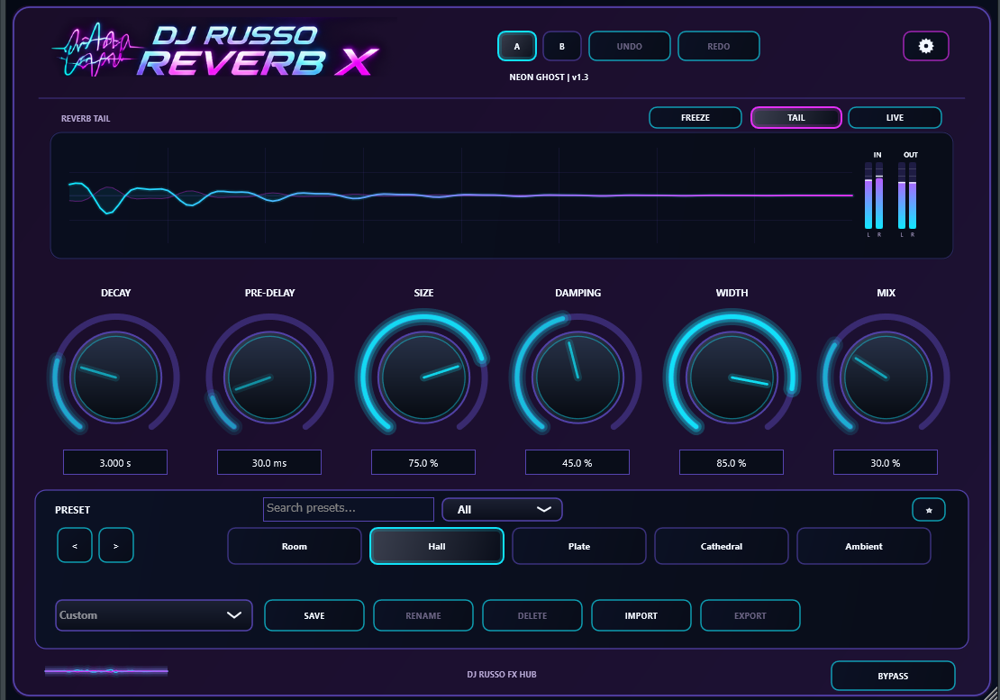

# DJ RUSSO FX HUB
### NEON GHOST

**Manage DJ RUSSO audio tools in one place.**

[**Download latest stable version**](https://github.com/djrusso1994/DJ-RUSSO-FX-HUB/releases/latest) · [**Windows builds**](https://github.com/djrusso1994/DJ-RUSSO-FX-HUB/actions) · [**Report an issue**](https://github.com/djrusso1994/DJ-RUSSO-FX-HUB/issues)

  

**Latest stable release: v0.8.44 · 9/14 audio tools available (64.3%)**

**8 VST effects + 1 standalone application · 5 tools remaining**

  

<em>FX HUB showcase · Real interface screenshots · Neon Ghost</em>

---

## Individual downloads — no FX HUB required

Prefer to download just one tool? These official Windows x64 binaries are the same payloads included in FX HUB v0.8.44.

| Tool | Version | Format | Download |
|---|---|---|---|
| **FX SHELL** — Sidechain X, Reverse FX, Stutter FX | 3.0.3 | VST3 | [Download VST3](https://raw.githubusercontent.com/djrusso1994/DJ-RUSSO-FX-HUB/2c6dcfef8ebd5da832bb40d1bb2bfb782e4b8d1a/Payload/DJ%20RUSSO%20FX%20SHELL.vst3) |
| **REVERB X** | 1.3 | VST3 | [Download VST3](https://raw.githubusercontent.com/djrusso1994/DJ-RUSSO-FX-HUB/2c6dcfef8ebd5da832bb40d1bb2bfb782e4b8d1a/Payload/DJ%20RUSSO%20REVERB%20X.vst3) |
| **DELAY X** | 1.3 | VST3 | [Download VST3](https://raw.githubusercontent.com/djrusso1994/DJ-RUSSO-FX-HUB/2c6dcfef8ebd5da832bb40d1bb2bfb782e4b8d1a/Payload/DJ%20RUSSO%20DELAY%20X.vst3) |
| **COMPRESSOR X** | 2.2 | VST3 | [Download VST3](https://raw.githubusercontent.com/djrusso1994/DJ-RUSSO-FX-HUB/7c15ea42c603ac397ac5e39bf8fd5a8144e0e2d8/Payload/DJ%20RUSSO%20COMPRESSOR%20X.vst3) |
| **EQ X** | 1.1.1 | VST3 | [Download VST3](https://raw.githubusercontent.com/djrusso1994/DJ-RUSSO-FX-HUB/89aecc51051d3cc9c1005e62f1fa8c34278c12da/Payload/DJ%20RUSSO%20EQ%20X.vst3) |
| **DRIVE X** | 1.3.3 | VST3 | [Download VST3](https://raw.githubusercontent.com/djrusso1994/DJ-RUSSO-FX-HUB/f2c72c828c339c3ab81aa54f7843523c00a8c216/Payload/DJ%20RUSSO%20DRIVE%20X.vst3) |
| **METER X** | 1.2.6 | Portable EXE | [Download EXE](https://raw.githubusercontent.com/djrusso1994/DJ-RUSSO-FX-HUB/2c6dcfef8ebd5da832bb40d1bb2bfb782e4b8d1a/Payload/DJ%20RUSSO%20METER%20X.exe) |

**Manual installation:** close your DAW, back up any existing plugin, then copy the downloaded `.vst3` file to `C:\Program Files\Common Files\VST3` (administrator permission may be required). Rescan your plugins in your DAW. METER X is a standalone Windows executable and does not belong in the VST3 folder.

FX SHELL is a single shared VST3 module containing three effects; do not split or duplicate it. These direct links are pinned to the verified release-source commits, not the development branch. They are raw binaries, not separate setup installers. For guided installation, conflict checks and HUB updates, use the [FX HUB installer](https://github.com/djrusso1994/DJ-RUSSO-FX-HUB/releases/latest).

---

## FX HUB interface

These real interface captures depict HUB v0.8.43.

| Bulk installation | Settings and security |
|:---:|:---:|
|  |  |
| **Diagnostics** | **Interactive guide** |
|  |  |

## FX HUB plugin gallery

| SIDECHAIN X · FX SHELL v3.0.3 | REVERSE FX · FX SHELL v3.0.3 |
|:---:|:---:|
|  |  |
| **STUTTER FX · FX SHELL v3.0.3** | **REVERB X v1.3** |
|  |  |
| **DELAY X v1.3** | **COMPRESSOR X v2.2** |
|  |  |
| **EQ X v1.1.1** | **METER X · standalone** |
|  |  |

METER X is a portable standalone application; Sidechain X, Reverse FX and Stutter FX share one FX SHELL VST3 module.

## What's new in v0.8.44 — current stable release

- **DRIVE X v1.3.3:** independent saturation VST3, six algorithms, 48 presets, harmonic preview and live spectrum.
- **Nine of fourteen tools:** individual verified downloads, safe installation/removal, bulk actions and diagnostics.
- **Five installer languages:** English (default), Italian, Spanish, French and German; first launch uses the chosen language, existing preferences are preserved.
- **Refined navigation:** Settings and VST detection are mutually exclusive, with persistent selected buttons and separate METER X standalone status.
- Existing audio binaries and the refreshed FX HUB showcase are preserved.

## Previous release: v0.8.43

- **EQ X v1.1.1:** independent dynamic EQ VST3, 16 bands, 48 factory presets, original logo and verified distribution.

- **COMPRESSOR X v2.2:** independent VST3 with original logo, integrated catalog and SHA-256 package verification.
- **8 of 14 audio tools available:** individual and bulk installation/removal, conflict protection, detection and diagnostics.
- **Individual downloads:** download the original plugin files without installing FX HUB.
- **Five interface languages:** English, Italian, Spanish, French and German.
- **Unified vector interface:** contextual icons across navigation, diagnostics, package integrity, installation/removal confirmations and reports, detection and the guide.
- **Software detection dashboard:** verified tool counts, progress bar, package cards, conflict/external installation indicators, expandable paths and rescan action.
- **Interactive user guide:** themed index, precise section navigation and a brief double-bounce highlight with neon glow.
- **Original startup music:** DJ RUSSO – Wave Pt. II, with the track title, optional playback at 30% volume, preserved fades and transition to the chip player without overlap.
- **Validation:** Windows build passed and the project owner approved the tested interface. Existing plugin binaries and DSP are unchanged.

[**Download FX HUB — latest published installer**](https://github.com/djrusso1994/DJ-RUSSO-FX-HUB/releases/latest)

## Previous release: v0.8.42

COMPRESSOR X v2.2 and verified individual downloads for seven available audio tools. See [v0.8.42 release](https://github.com/djrusso1994/DJ-RUSSO-FX-HUB/releases/tag/v0.8.42) and the cumulative [changelog](CHANGELOG.txt).

## Earlier release: v0.8.41

- **DELAY X v1.3 released:** independent Neon Ghost VST3 effect with its original logo, SHA-256 integrity verification and safe installation/removal.
- **Expanded audio-tool catalog:** six of fourteen planned effects/tools are now available: Sidechain X, Reverse FX, Stutter FX, METER X, REVERB X and DELAY X.
- **Install/remove all:** added DELAY X to bulk operations, individual plugin management and installation-state checks without changing the audio engines.
- **Redesigned diagnostics:** clearer grouped results, status indicators and package-integrity information, consistent with the Neon Ghost interface.
- **Refined operation dialogs:** improved installation/removal confirmations and final status reports for individual and bulk operations.
- **Crash fix and faster feedback:** corrected the WPF operation-summary crash and show bulk-operation results before refreshing the product cards.
- **Existing audio DSP preserved:** previous plugin binaries, IDs and audio-processing behavior are unchanged.

**[Download DJ RUSSO FX HUB v0.8.41](https://github.com/djrusso1994/DJ-RUSSO-FX-HUB/releases/tag/v0.8.41)** · [Latest stable installer](https://github.com/djrusso1994/DJ-RUSSO-FX-HUB/releases/latest)

## Included tools

**Nine available audio tools** are managed through one Windows application:

- **DJ RUSSO METER X v1.2.6** — Windows audio monitoring application.
- **DJ RUSSO FX SHELL v3.0.3** — one shared VST3 module containing **Sidechain X**, **Reverse FX**, and **Stutter FX**.
- **DJ RUSSO REVERB X v1.3** — independent Neon Ghost VST3 effect with adjustable reverb controls, stereo IN/OUT meters, presets, and FL Studio automation support.
- **DJ RUSSO DELAY X v1.3** — independent Neon Ghost VST3 delay effect with stereo delay controls, presets, and FL Studio automation support.
- **DJ RUSSO COMPRESSOR X v2.2** — independent VST3 dynamics effect.
- **DJ RUSSO EQ X v1.1.1** — independent dynamic EQ VST3.
- **DJ RUSSO DRIVE X v1.3.3** — independent saturation VST3 with six algorithms and live spectrum.
- **More audio tools** — visible as *Coming Soon* in the catalog, but not yet available for installation.

The FX HUB itself is a **Windows application, not a VST3 plugin**. FX SHELL, REVERB X, DELAY X, COMPRESSOR X, EQ X, DRIVE X and METER X can be installed or removed individually, or managed together with the supported bulk actions.

## Previous release: v0.8.40

- **REVERB X v1.3 is now available:** its own catalog card, original logo, independent VST3 installer, and SHA-256 package integrity verification.
- **Safer VST3 management:** distinguish installed, externally installed and conflicting or modified files. A **Resolve Conflict** action explains what to do and can open the VST3 directory without automatically deleting or overwriting plugins.
- **Bulk install and removal:** REVERB X is now included alongside FX SHELL and METER X, with consistent status messages.
- **Updated diagnostics:** verify the bundled REVERB X package and display its installed state, alongside the existing tools.
- **Improved in-app guide:** clearer typography, localized instructions, scrollbars that match the interface and a clickable official support link.
- **Refined multilingual UI:** improved notifications, confirmation messages and status labels in English, Italian, Spanish, French and German.
- **Existing audio processing preserved:** no changes to the DSP of the previously released VST3 effects.

**[Download DJ RUSSO FX HUB v0.8.40](https://github.com/djrusso1994/DJ-RUSSO-FX-HUB/releases/tag/v0.8.40)** · [Latest stable release](https://github.com/djrusso1994/DJ-RUSSO-FX-HUB/releases/latest)

## Earlier release: v0.8.39

- **Improved theme consistency:** refined contrast, borders, buttons and text readability across **Neon Ghost**, **Dark Professional** and **Light Modern**.
- **More readable controls:** improved dropdown presentation, plugin-update button and selected-tool panel styling.
- **Responsive notifications:** adjusted toast positioning to remain visible across different Windows screen resolutions and taskbar layouts.
- **Interface localization:** refined multilingual labels and update-status translations.
- **Existing audio tools preserved:** no changes to VST3 audio DSP, plugin identities or installer paths.

The v0.8.39 release introduced the theme, layout and localization refinements listed above. Versions v0.8.40 and v0.8.41 build on those improvements.

For the exact version history, see [CHANGELOG.txt](CHANGELOG.txt). The download and release status are always shown on [GitHub Releases](https://github.com/djrusso1994/DJ-RUSSO-FX-HUB/releases).

### Test the update-window preview

Open the left sidebar and select **ANTEPRIMA AGGIORNAMENTO**, or use the preview control in **Settings**. This is a visual simulation, not an actual update; it does not download, install or replace any files.

### VirusTotal and installer safety

To scan the installer, download it from the official [GitHub Releases](https://github.com/djrusso1994/DJ-RUSSO-FX-HUB/releases), then choose the VirusTotal button in Settings and **manually select that downloaded EXE** on VirusTotal. A missing VirusTotal report for an SHA-256 hash is **not** evidence that the file is malicious or safe. Uploading files to VirusTotal shares them with that service; review its privacy terms before uploading.

## Features

- Install and remove supported DJ RUSSO tools.
- View installation status and launch supported applications.
- Search and filter the audio-tool catalog.
- Choose interface language and one of three visual themes: Neon Ghost, Dark Professional or Light Modern.
- Check GitHub Releases for newer versions, including preview releases.
- Open diagnostics, backup tools and the VST3 directory.
- Neon Ghost visual design, optional original startup music (Wave Pt. II) and mini chip player.
- Interactive five-language guide and contextual vector icons.

## Download and install

1. Open the [latest stable GitHub release](https://github.com/djrusso1994/DJ-RUSSO-FX-HUB/releases/latest).
2. Download the Windows x64 **Setup .exe** from the latest published release.
3. Run the installer and launch **DJ RUSSO FX HUB**.
4. Close your DAW before installing or removing VST3 effects.
5. Open FL Studio's Plugin Manager and rescan plugins after installation.

**Latest published build:** see [GitHub Releases](https://github.com/djrusso1994/DJ-RUSSO-FX-HUB/releases). The release link above opens the latest stable release.

## Compatibility and important notes

- Windows x64; developed with WPF and .NET 8.
- FL Studio is the primary testing DAW; other VST3 hosts are not yet fully validated.
- FX SHELL contains three effects in **one shared VST3 file**. Do not manually split or duplicate it.
- REVERB X v1.3, DELAY X v1.3, COMPRESSOR X v2.2, EQ X v1.1.1 and DRIVE X v1.3.3 install as **independent VST3 effects**, separately from FX SHELL.
- If a different or modified VST3 is detected at the destination, the HUB blocks automatic replacement and offers a **Resolve Conflict** explanation. Close your DAW and back up existing files before making manual changes.
- Installation may require Windows administrator permission.
- Always back up important projects and plugins before testing.
- The HUB checks official GitHub Releases for updates. When a compatible installer includes a SHA-256 digest, it can offer a user-confirmed download, integrity check and installer launch; otherwise it opens the release in the browser. Updates are never installed silently.
- The source project builds the HUB and bundles precompiled payloads. It does **not** build the JUCE audio DSP.

## Development and release process

The latest stable release link at the top of this page always opens the current stable GitHub release. See [GitHub Releases](https://github.com/djrusso1994/DJ-RUSSO-FX-HUB/releases) for the current installer, release notes and whether a release is marked as a pre-release.

GitHub Actions builds the Windows application from source. A successful build verifies compilation, **not** correct behavior on every Windows PC. Stable releases require approval after Windows testing. GitHub Actions artifacts and published GitHub Releases are separate download channels. Each release must also refresh this README, both vector badges, the download catalog and the cumulative changelog according to [the release checklist](AGENTS.md).

### Update and security behavior

- **HUB updates:** check official releases, offer guided installer download when supported, verify the published SHA-256 digest and request confirmation before launch.
- **VirusTotal:** provide a link to the report for the exact published installer digest when available; this does not upload files or guarantee that a build is malware-free.
- **Installed tools:** detect supported VST3 installations and distinguish managed files from conflicting or modified installations where verification is available.
- **Diagnostics and backups:** offer local diagnostic and backup utilities.
- **Plugin updates:** automatic VST3 plugin updates are not yet implemented. Do not confuse HUB application updates with plugin updates.

The development branch may contain unreleased changes. For confirmed downloads and release-specific details, always refer to the [published release notes](https://github.com/djrusso1994/DJ-RUSSO-FX-HUB/releases).

## Build from source

Open `DJRussoFXHub.slnx` with Visual Studio 2022 or later and the **.NET desktop development** workload, then build for Windows x64. Keep the bundled `Payload` files alongside the published application.

---

**Created by DJ RUSSO** · [Official downloads](https://github.com/djrusso1994/DJ-RUSSO-FX-HUB/releases)

