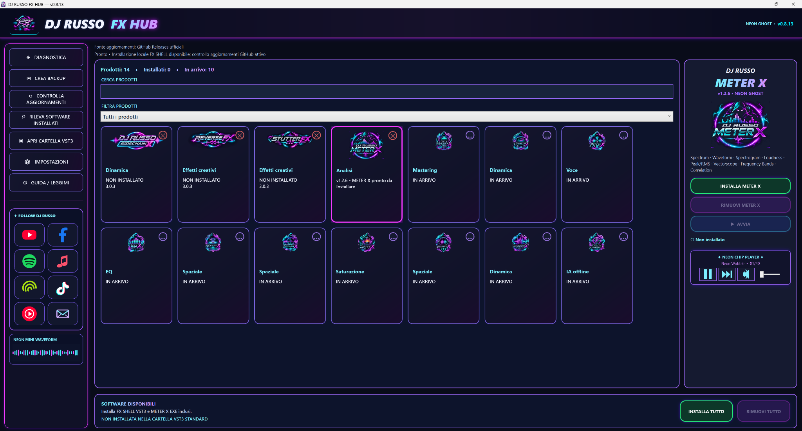

# DJ RUSSO FX HUB
### NEON GHOST · Audio Tools Manager for Windows

**Manage DJ RUSSO audio tools in one place.**

[**Download latest stable version**](https://github.com/djrusso1994/DJ-RUSSO-FX-HUB/releases/latest) · [**Windows builds**](https://github.com/djrusso1994/DJ-RUSSO-FX-HUB/actions) · [**Report an issue**](https://github.com/djrusso1994/DJ-RUSSO-FX-HUB/issues)

  

---

## Interface gallery

Explore the real **DJ RUSSO FX HUB** interface. Click any screenshot to view it at full resolution.

| **Main Dashboard** | **Installed Plugins** |
|:---:|:---:|
|  |  |

| **METER X Monitoring** | **Dark Professional Theme** |
|:---:|:---:|
|  |  |

## Included tools

**Five available audio tools** are managed through one Windows application:

- **DJ RUSSO METER X v1.2.6** — Windows audio monitoring application.
- **DJ RUSSO FX SHELL v3.0.3** — one shared VST3 module containing **Sidechain X**, **Reverse FX**, and **Stutter FX**.
- **DJ RUSSO REVERB X v1.3** — independent Neon Ghost VST3 effect with adjustable reverb controls, stereo IN/OUT meters, presets, and FL Studio automation support.
- **More audio tools** — visible as *Coming Soon* in the catalog, but not yet available for installation.

The FX HUB itself is a **Windows application, not a VST3 plugin**. FX SHELL, REVERB X and METER X can be installed or removed individually, or managed together with the supported bulk actions.

## What's new in v0.8.40

- **REVERB X v1.3 is now available:** its own catalog card, original logo, independent VST3 installer, and SHA-256 package integrity verification.
- **Safer VST3 management:** distinguish installed, externally installed and conflicting or modified files. A **Resolve Conflict** action explains what to do and can open the VST3 directory without automatically deleting or overwriting plugins.
- **Bulk install and removal:** REVERB X is now included alongside FX SHELL and METER X, with consistent status messages.
- **Updated diagnostics:** verify the bundled REVERB X package and display its installed state, alongside the existing tools.
- **Improved in-app guide:** clearer typography, localized instructions, scrollbars that match the interface and a clickable official support link.
- **Refined multilingual UI:** improved notifications, confirmation messages and status labels in English, Italian, Spanish, French and German.
- **Existing audio processing preserved:** no changes to the DSP of the previously released VST3 effects.

**[Download DJ RUSSO FX HUB v0.8.40](https://github.com/djrusso1994/DJ-RUSSO-FX-HUB/releases/tag/v0.8.40)** · [Latest stable installer](https://github.com/djrusso1994/DJ-RUSSO-FX-HUB/releases/latest)

## Previous release: v0.8.39

- **Improved theme consistency:** refined contrast, borders, buttons and text readability across **Neon Ghost**, **Dark Professional** and **Light Modern**.
- **More readable controls:** improved dropdown presentation, plugin-update button and selected-tool panel styling.
- **Responsive notifications:** adjusted toast positioning to remain visible across different Windows screen resolutions and taskbar layouts.
- **Interface localization:** refined multilingual labels and update-status translations.
- **Existing audio tools preserved:** no changes to VST3 audio DSP, plugin identities or installer paths.

The v0.8.39 release introduced the theme, layout and localization refinements listed above. Version v0.8.40 builds on those improvements.

For the exact version history, see [CHANGELOG.txt](CHANGELOG.txt). The download and release status are always shown on [GitHub Releases](https://github.com/djrusso1994/DJ-RUSSO-FX-HUB/releases).

### Test the update-window preview

Open the left sidebar and select **ANTEPRIMA AGGIORNAMENTO**, or use the preview control in **Settings**. This is a visual simulation, not an actual update; it does not download, install or replace any files.

### VirusTotal and installer safety

To scan the installer, download it from the official [GitHub Releases](https://github.com/djrusso1994/DJ-RUSSO-FX-HUB/releases), then choose the VirusTotal button in Settings and **manually select that downloaded EXE** on VirusTotal. A missing VirusTotal report for an SHA-256 hash is **not** evidence that the file is malicious or safe. Uploading files to VirusTotal shares them with that service; review its privacy terms before uploading.

## Features

- Install and remove supported DJ RUSSO tools.
- View installation status and launch supported applications.
- Search and filter the audio-tool catalog.
- Choose interface language and one of three visual themes: Neon Ghost, Dark Professional or Light Modern.
- Check GitHub Releases for newer versions, including preview releases.
- Open diagnostics, backup tools and the VST3 directory.
- Neon Ghost visual design and mini chip player.

## Download and install

1. Open the [latest stable GitHub release](https://github.com/djrusso1994/DJ-RUSSO-FX-HUB/releases/latest).
2. Download the Windows x64 **Setup .exe** from the latest published release.
3. Run the installer and launch **DJ RUSSO FX HUB**.
4. Close your DAW before installing or removing VST3 effects.
5. Open FL Studio's Plugin Manager and rescan plugins after installation.

**Latest published build:** see [GitHub Releases](https://github.com/djrusso1994/DJ-RUSSO-FX-HUB/releases). The release link above opens the latest stable release.

## Compatibility and important notes

- Windows x64; developed with WPF and .NET 8.
- FL Studio is the primary testing DAW; other VST3 hosts are not yet fully validated.
- FX SHELL contains three effects in **one shared VST3 file**. Do not manually split or duplicate it.
- REVERB X v1.3 installs as its **own VST3**, independently of FX SHELL.
- If a different or modified VST3 is detected at the destination, the HUB blocks automatic replacement and offers a **Resolve Conflict** explanation. Close your DAW and back up existing files before making manual changes.
- Installation may require Windows administrator permission.
- Always back up important projects and plugins before testing.
- The HUB checks official GitHub Releases for updates. When a compatible installer includes a SHA-256 digest, it can offer a user-confirmed download, integrity check and installer launch; otherwise it opens the release in the browser. Updates are never installed silently.
- The source project builds the HUB and bundles precompiled payloads. It does **not** build the JUCE audio DSP.

## Development and release process

The latest stable release link at the top of this page always opens the current stable GitHub release. See [GitHub Releases](https://github.com/djrusso1994/DJ-RUSSO-FX-HUB/releases) for the current installer, release notes and whether a release is marked as a pre-release.

GitHub Actions builds the Windows application from source. A successful build verifies compilation, **not** correct behavior on every Windows PC. Stable releases require approval after Windows testing. GitHub Actions artifacts and published GitHub Releases are separate download channels.

### Update and security behavior

- **HUB updates:** check official releases, offer guided installer download when supported, verify the published SHA-256 digest and request confirmation before launch.
- **VirusTotal:** provide a link to the report for the exact published installer digest when available; this does not upload files or guarantee that a build is malware-free.
- **Installed tools:** detect supported VST3 installations and distinguish managed files from conflicting or modified installations where verification is available.
- **Diagnostics and backups:** offer local diagnostic and backup utilities.
- **Plugin updates:** automatic VST3 plugin updates are not yet implemented. Do not confuse HUB application updates with plugin updates.

The development branch may contain unreleased changes. For confirmed downloads and release-specific details, always refer to the [published release notes](https://github.com/djrusso1994/DJ-RUSSO-FX-HUB/releases).

## Build from source

Open `DJRussoFXHub.slnx` with Visual Studio 2022 or later and the **.NET desktop development** workload, then build for Windows x64. Keep the bundled `Payload` files alongside the published application.

---

**Created by DJ RUSSO** · [Official downloads](https://github.com/djrusso1994/DJ-RUSSO-FX-HUB/releases)

