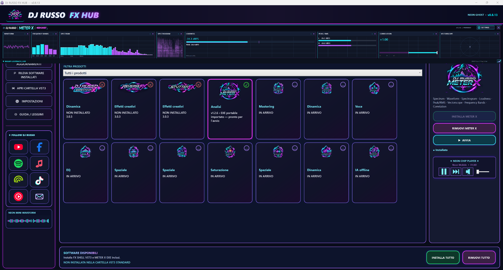
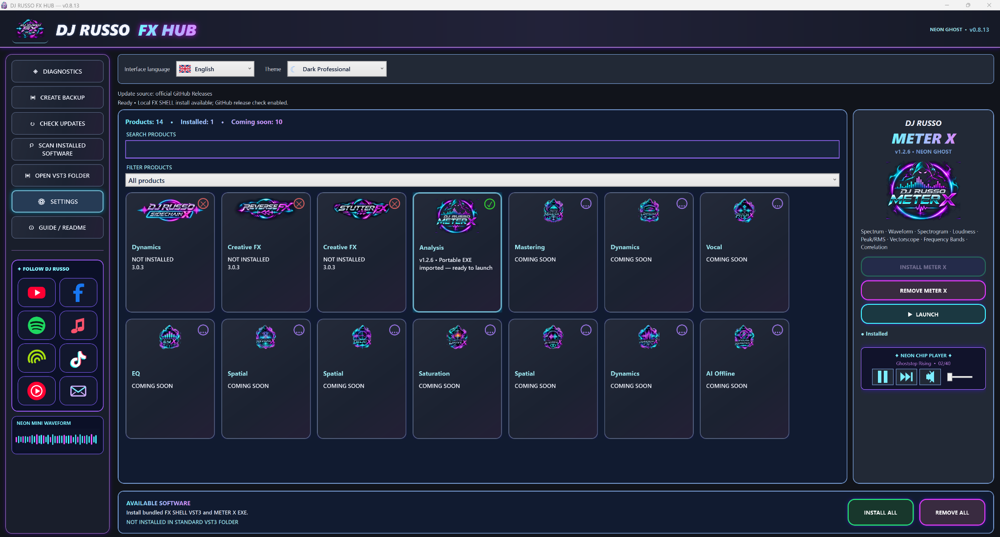

# DJ RUSSO FX HUB
### NEON GHOST · Audio Tools Manager for Windows

**Manage DJ RUSSO audio tools in one place.**

[**Download latest public version**](https://github.com/djrusso1994/DJ-RUSSO-FX-HUB/releases) · [**Windows builds**](https://github.com/djrusso1994/DJ-RUSSO-FX-HUB/actions) · [**Report an issue**](https://github.com/djrusso1994/DJ-RUSSO-FX-HUB/issues)

  

---

## Interface gallery

Explore the real **DJ RUSSO FX HUB** interface. Click any screenshot to view it at full resolution.

| **Main Dashboard** | **Installed Plugins** |
|:---:|:---:|
|  |  |

| **METER X Monitoring** | **Dark Professional Theme** |
|:---:|:---:|
|  |  |

## Included tools

- **DJ RUSSO METER X** — Windows audio monitoring application.
- **DJ RUSSO FX SHELL** — a single VST3 module providing **Sidechain X**, **Reverse FX**, and **Stutter FX**.
- **More audio tools** — shown as *Coming Soon*; not yet available for installation.

The FX HUB itself is a Windows application, **not a VST3 plugin**.

## Coming next: DJ RUSSO REVERB X v1.3\n\n**DJ RUSSO REVERB X v1.3** is the next VST3 addition planned for **DJ RUSSO FX HUB v0.8.40**. The compiled Windows VST3 package has been received and is being prepared for HUB integration.\n\n- **Reverb X card:** retain its existing position in the catalog; replace the *Coming Soon* status only after installation support is verified.\n- **Visual identity:** use the original REVERB X logo at the same visual size as the other plugin cards.\n- **Plugin features:** Neon Ghost interface, six controls with progressive glow, stereo IN/OUT meters, presets and FL Studio automation support.\n- **Release status:** v0.8.40 is **not yet published**. The new VST3 is not available through the current public HUB installer until integration and Windows tests are complete.\n\n## What's new in v0.8.39

- **Improved theme consistency:** refined contrast, borders, buttons and text readability across **Neon Ghost**, **Dark Professional** and **Light Modern**.
- **More readable controls:** improved dropdown presentation, plugin-update button and selected-tool panel styling.
- **Responsive notifications:** adjusted toast positioning to remain visible across different Windows screen resolutions and taskbar layouts.
- **Interface localization:** refined multilingual labels and update-status translations.
- **Existing audio tools preserved:** no changes to VST3 audio DSP, plugin identities or installer paths.

The v0.8.39 Windows build was tested before its stable public release.

For the exact version history, see [CHANGELOG.txt](CHANGELOG.txt). The download and release status are always shown on [GitHub Releases](https://github.com/djrusso1994/DJ-RUSSO-FX-HUB/releases).

### Test the update-window preview

Open the left sidebar and select **ANTEPRIMA AGGIORNAMENTO**, or use the preview control in **Settings**. This is a visual simulation, not an actual update; it does not download, install or replace any files.

### VirusTotal and installer safety

To scan the installer, download it from the official [GitHub Releases](https://github.com/djrusso1994/DJ-RUSSO-FX-HUB/releases), then choose the VirusTotal button in Settings and **manually select that downloaded EXE** on VirusTotal. A missing VirusTotal report for an SHA-256 hash is **not** evidence that the file is malicious or safe. Uploading files to VirusTotal shares them with that service; review its privacy terms before uploading.

## Features

- Install and remove supported DJ RUSSO tools.
- View installation status and launch supported applications.
- Search and filter the audio-tool catalog.
- Choose interface language and one of three visual themes: Neon Ghost, Dark Professional or Light Modern.
- Check GitHub Releases for newer versions, including preview releases.
- Open diagnostics, backup tools and the VST3 directory.
- Neon Ghost visual design and mini chip player.

## Download and install

1. Open [GitHub Releases](https://github.com/djrusso1994/DJ-RUSSO-FX-HUB/releases).
2. Download the Windows x64 **Setup .exe** from the latest published release.
3. Run the installer and launch **DJ RUSSO FX HUB**.
4. Close your DAW before installing or removing VST3 effects.
5. Open FL Studio's Plugin Manager and rescan plugins after installation.

**Latest published build:** see [GitHub Releases](https://github.com/djrusso1994/DJ-RUSSO-FX-HUB/releases). The version badge above shows the latest stable release; GitHub and badge-provider caches may update at different times.

## Compatibility and important notes

- Windows x64; developed with WPF and .NET 8.
- FL Studio is the primary testing DAW; other VST3 hosts are not yet fully validated.
- FX SHELL contains three effects in **one shared VST3 file**. Do not manually split or duplicate it.
- Installation may require Windows administrator permission.
- Always back up important projects and plugins before testing.
- The HUB checks official GitHub Releases for updates. When a compatible installer includes a SHA-256 digest, it can offer a user-confirmed download, integrity check and installer launch; otherwise it opens the release in the browser. Updates are never installed silently.
- The source project builds the HUB and bundles precompiled payloads. It does **not** build the JUCE audio DSP.

## Development and release process

The latest published version is displayed automatically by the release badge at the top of this page. See [GitHub Releases](https://github.com/djrusso1994/DJ-RUSSO-FX-HUB/releases) for the current installer, release notes and whether a release is marked as a pre-release.

GitHub Actions builds the Windows application from source. A successful build verifies compilation, **not** correct behavior on every Windows PC. Stable releases require approval after Windows testing. GitHub Actions artifacts and published GitHub Releases are separate download channels.

### Update and security behavior

- **HUB updates:** check official releases, offer guided installer download when supported, verify the published SHA-256 digest and request confirmation before launch.
- **VirusTotal:** provide a link to the report for the exact published installer digest when available; this does not upload files or guarantee that a build is malware-free.
- **Installed tools:** detect supported VST3 installations and distinguish managed files from conflicting or modified installations where verification is available.
- **Diagnostics and backups:** offer local diagnostic and backup utilities.
- **Plugin updates:** automatic VST3 plugin updates are not yet implemented. Do not confuse HUB application updates with plugin updates.

The development branch may contain unreleased changes. For confirmed downloads and release-specific details, always refer to the [published release notes](https://github.com/djrusso1994/DJ-RUSSO-FX-HUB/releases).

## Build from source

Open `DJRussoFXHub.slnx` with Visual Studio 2022 or later and the **.NET desktop development** workload, then build for Windows x64. Keep the bundled `Payload` files alongside the published application.

---

**Created by DJ RUSSO** · [Official downloads](https://github.com/djrusso1994/DJ-RUSSO-FX-HUB/releases)

